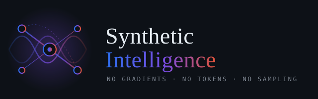

<div align="center">



<br>

[](../../actions)
[](LICENSE)
[](#-status-early-development)
[](SI/incomplete.md)
[](SI/research-paper)
[](SI/src)
[](#build)

**A graph-physics substrate for structural reasoning.**
No gradients. No backpropagation. No learned embeddings. No next-token prediction.

</div>

---

## ⚠️ Status: early development

**This is a research prototype, not a product, and not a finished
architecture.** The project maintains its own gap audit — see
[`SI/incomplete.md`](SI/incomplete.md) — which currently reports:

> **53 paper mechanisms identified. 28 fully implemented. 12 partially. 13 missing.**

Read that file before forming an opinion about what this does. It is
more critical of the system than any external review has been, and it is
kept current deliberately.

| Layer | Coverage |
| --- | --- |
| Reasoning primitives | 90% |
| Physics substrate | 85% |
| Discovery queries | 83% |
| Attention / salience | 75% |
| Language (CLL) | 67% |
| Identity (RIFA) | 60% |
| Consciousness (BSMA) | 50% |
| Learning / meta | 50% |
| Wave I/O (emission) | 40% |

---

## A different branch, not a smaller model

**This is experimental work proposing a separate lineage.** It is not a
lightweight LLM, not a distilled model, not a neurosymbolic wrapper
around one, and not an attempt to reach the same destination by a
cheaper road. It is a bet that there is a *different* road.

### What it does not inherit — and how to check

Every row below is verifiable by reading `SI/src/`. There is no hidden
model, no downloaded checkpoint, and no network call at inference.

| Not present | How to confirm |
| --- | --- |
| **Gradients / backpropagation** | no loss function, no autodiff, no optimiser anywhere in `src/` |
| **Learned embeddings** | a concept is a cavity with mass, displacement and velocity — no vector table |
| **Next-token prediction** | nothing computes `P(w_n \| w_1..w_{n-1})` |
| **Sampling / temperature** | output is a total function of state; the same input yields byte-identical output |
| **Attention** | no attention matrix; propagation is local force between coupled endpoints |
| **A training corpus** | the substrate is built from plain-text triples, readable in `data/` |
| **Fitted parameters** | relation materials are *derived* from fan-out, not tuned |
| **A tokenizer** | input drives 256 byte lanes; recognition is graded, not a vocabulary lookup |

The engine is **~250 KB of C++ with zero dependencies**. Nothing about
it can be doing statistics in secret, and that is the point of stating
the claim this way — it is falsifiable by `grep`.

### What it *does* draw on, stated honestly

Claiming to inherit nothing would be a weaker position, not a stronger
one, because it is false and a reviewer will find it in a minute:

- **Symbolic AI.** Typed graph rewriting and forward chaining are
  classical inference, well understood since the 1970s. This project
  uses them and does not pretend otherwise. The **derivation** in an
  answer comes from here.
- **Computational neuroscience.** Kuramoto phase coupling, Izhikevich
  dynamics, Hebbian consolidation, Curie-point habituation. These are
  physics-of-neurons, not machine learning, but they are borrowed.
- **Information theory.** Character n-gram sensory lanes and the
  rarity weighting on bindings predate machine learning entirely.

**The one genuinely new claim** is the arrangement: that a physics
substrate can supply *relevance* while a symbolic layer supplies
*derivation*, with the translation cost between them named rather than
hidden — and that a system built this way can be **wrong in a way it
notices**.

### How to falsify the "different branch" claim

The claim dies if any of these is shown:

1. The physics layer can be replaced by a similarity score with no loss
   of capability. *(This is the strongest attack, and it is not yet
   ruled out — see the note on Layer 1's actual contribution in
   [`SI/incomplete.md`](SI/incomplete.md).)*
2. Any answer it gives is traceable to a stored `(query, answer)` pair
   rather than a derivation.
3. Its output distribution shifts under reseeding — it does not, because
   nothing is sampled.

A new branch of intelligence is a large claim, and this repository is
the attempt to earn it rather than the announcement that it has been
earned. **Today it is a prototype that is 53% of its own specification.**

---

## What it actually does

Concepts are **coupled oscillators**. Relations are **materials** with
stiffness, damping and phase offset. Inference is **wave propagation**.
Output is a phase-swept projection through a deterministic language
table.

Four things it does that are worth checking:

**Derives facts nobody asserted, and cites its premises.**
100 edges in the default ontology appear in no axiom file. Each names
the two premises that produced it, recursively, to the asserted root.

```
you> what is linux
si > Linux has the posix compliance.
     Linux is a software.  [derived]
       linux is_a operating_system   [asserted]
       operating_system is_a software [asserted]
```

**Corrects itself against an external oracle.**
It forms a hypothesis about a function's signature, emits real C++,
hands it to `g++`, and rewrites its graph when the compiler disagrees.
Facts established this way carry a third provenance class — neither
asserted nor rule-derived. Cost on a repeated target falls from 3
experiments to 1.

**Can be wrong in a way it notices.**
It forms universals stronger than its evidence, then destroys them.
Its own induction *"every function takes at least one argument"* was
refuted by `tick()`, and the refutation is logged.

**Speaks three protocols from one cognitive state, without sampling.**
```
(metformin, inhibits, mtor)   en: Metformin inhibits mtor.
                              bn: Metformin mtor বাধা দেয়।
                              bl: Metformin mtor badha dey.
```

---

## What it does not do

Stated plainly, because the interesting claim is not worth making if
these are hidden:

- **It cannot produce a word it does not already store.** Recognition is
  grounded in bytes and survives misspelling; emission of novel word
  forms babbles. Input is solved, output is not.
- **The thinker index is not measured at runtime.** The C/R metric that
  would answer *"is this constructing or retrieving?"* is implemented
  and **never invoked**. See `incomplete.md` §5.
- **Discovery queries are unreachable from the interface.** Isolated
  subgraphs, logic gaps and anomalies are computed and never surfaced.
- **It does not mind-wander.** The default-mode layer generates candidate
  distant pairs and never acts on them.
- **Anomaly detection and synthesis are not connected.** Both exist. One
  does not feed the other.
- **It is small.** ~2,700 concepts by default. A ConceptNet-scale
  ontology (157k) loads but the Layer-1 tick is dense, so queries are
  slow.
- **No stochasticity anywhere.** Fully deterministic, which is a design
  choice with real costs.

---

## Build

No dependencies beyond a C++17 compiler.

```bash
cd SI
make si
./si
```

That is the whole interface. **No flags, no subcommands.** The input
selects the behaviour: what you ask determines the shape of the answer,
and Bengali in gets Bengali out.

State persists to `pcma.si` — one file holding both the concept graph
and the physical state the substrate reached. Delete it with
`make reset` to rebuild from `data/*.axioms`.

### Reproducibility harnesses

```bash
make harnesses
./harness-jas       # the J-A-S cycle and the impossibility register
./harness-synth     # hypothesis -> emitted C++ -> compiler verdict
./harness-codeq     # structural code queries with proof chains
```

These are not features. Each pins one published measurement so a reader
can check a number directly.

---

## Repository layout

```
SI/
├── src/              the engine — one binary, header-only substrate
├── data/             ontologies as plain-text axiom triples
├── research-paper/   54 papers + build tooling
├── tools/            extractors, paper build, link checker
├── legacy/           retired DCHL lineage, kept for provenance
├── incomplete.md     the gap audit — read this
└── ROADMAP.md        phase-by-phase status
```

---

## Papers

54 papers build to PDF and group into **10 Zenodo volumes**.

```bash
./tools/build_papers.sh          # all papers -> PDF
python3 tools/build_volumes.py   # grouped depositions
python3 tools/check_links.py     # verify every citation resolves
```

Start with **`research-paper/synthetic-intelligence.md`** — the framework
paper. Then, depending on interest:

| Volume | Subject |
| --- | --- |
| Substrate | how a concept becomes a mechanical object |
| Emission | how a settled field becomes ordered output |
| Structure | contradiction, fission, mutation, geometry |
| Language | why grammar cannot be discovered by physics |
| Epistemology | induction, refutation, and the warrant of "impossible" |
| Retrospective | the architecture that failed, and what survived it |
| Dead & Deprecated | formally retired, kept for provenance |

Two conventions the papers follow, and the reason they exist:

**Sections marked RETIRED or historical are kept, not deleted.** A
negative result that is deleted stops being evidence. The paper describing
the failed physics-grammar pipeline is retained precisely because the
hypothesis was wrong *in kind*, which is a result.

**A dead paper is not a retracted one.** Four mechanisms whose papers are
filed as retired are load-bearing today. The Retrospective volume names
each one and says which half survived.

---

## Honest positioning

This is **not** an LLM, and not a competitor to one. It does not write
prose, summarise documents, or answer open-domain questions. It has no
world model beyond the triples it was given.

What it has is a different failure mode. A language model fails by
producing fluent falsehood, which is undetectable from the output alone.
This fails by producing an **explicit gap** — it says nothing rather than
inventing something — and when it does answer, it can show the
derivation.

Whether that is worth the enormous loss in fluency is an open question,
and this repository is the attempt to find out rather than the claim to
have.

---

## Citing

```bibtex
@software{mahir_si,
  author  = {Mahir, Irfan},
  title   = {Synthetic Intelligence: A Graph-Physics Substrate
             for Structural Reasoning},
  year    = {2026},
  note    = {Early development. See incomplete.md for the gap audit.},
  url     = {https://github.com/irfanmahir/SI}
}
```

---

## License

[GNU AGPL v3](LICENSE). Network use counts as distribution: if you run a
modified version as a service, the modified source must be available to
its users.

---

<div align="center">

**Irfan Mahir** · Independent Researcher, Dhaka, Bangladesh
[irfan@furylogic.com](mailto:irfan@furylogic.com)

</div>
